<h1>
  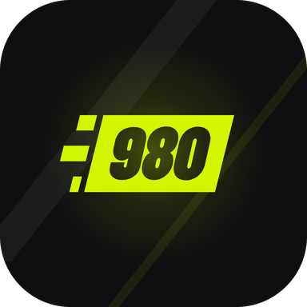
  &nbsp;Scale 980 Garage
</h1>

**A maintenance log for one mountain bike, built as a *Need for Speed*-style garage.**
A native Android app (Kotlin + Jetpack Compose + Google Filament) for my SCOTT Scale 980 hardtail. A procedurally generated 3D model of the real bike stands on a turntable in a neon garage. Tap any of its parts to see its condition, service history, issues and replacements.

<p align="center">
  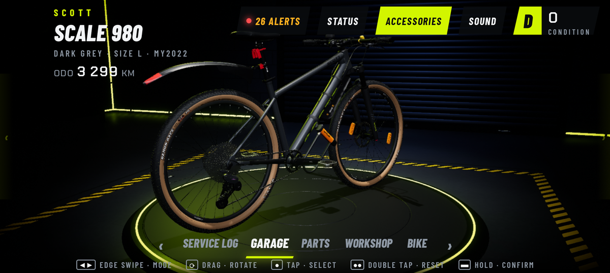
</p>

> Personal project by **Toni ([@bostan7](https://github.com/bostan7))**. It is built for one bike and one phone (Google Pixel 9 Pro, landscape), fully offline, with no accounts and no servers.

---

## Contents

- [Demo](#demo)
- [What it does](#what-it-does)
- [Screenshots](#screenshots)
- [The 3D model](#the-3d-model)
- [How it works](#how-it-works)
- [Controls](#controls)
- [Build & run](#build--run)
- [Regenerate the 3D model](#regenerate-the-3d-model)
- [Repository layout](#repository-layout)
- [Status](#status)
- [Credits & licences](#credits--licences)
- [Disclaimer](#disclaimer)
- [License](#license)

---

## Demo


| Intro | Swipe between modes |
|:---:|:---:|
| 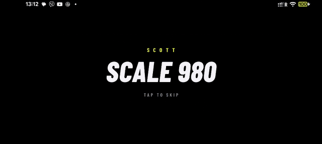 | 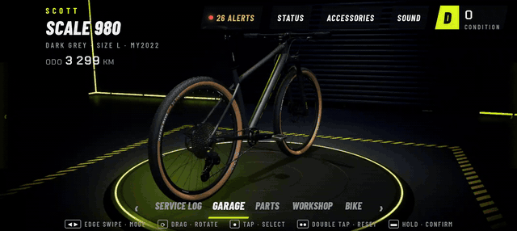 |
| **Tap a part** | **Accessories on / off** |
| 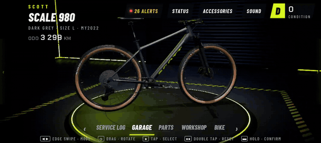 | 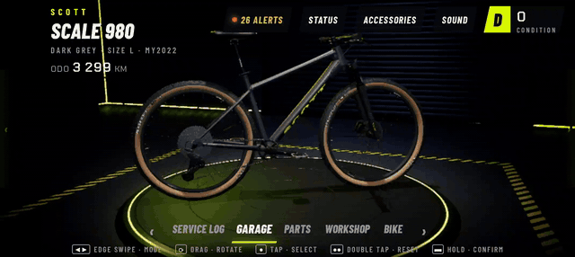 |

---

## What it does

**A 3D garage, not a list of screens**
- The real bike as a detailed 3D model (558k triangles, 23 named parts + 8 accessories) on a turntable with a neon ring, in a night garage with wet concrete, block walls, a roll-up shutter and a hexagon LED ceiling.
- Game-style UI over the 3D view: nameplate and odometer, condition badge, alert counter, an intro where the garage lights switch on, menu sounds and haptics.
- Five modes you swipe between: **SERVICE LOG · GARAGE · PARTS · WORKSHOP · BIKE**. Each one moves the camera and slides in its own panel.
- **Tap any part on the bike.** Filament picking finds the part, the camera flies to it and a part card opens with its condition.
- **Status view.** Every part glows green, amber or red by its condition.
- **Accessories chip.** Shows or hides the mudguards, lights, bell, lock and spoke reflectors.
- Important actions use **hold-to-confirm** instead of pop-up dialogs.

**A real maintenance log**
- Every part tracks its brand/model/spec, install date and odometer, price and shop, service interval (km and/or days), pros and cons, notes, history (install / service / inspection / repair / removed) and **issues with photos**.
- **Condition logic.** Progress = max(km since service ÷ km interval, days since service ÷ day interval). The result is OK, *due soon* (≥ 80 %) or *overdue*, and open issues raise it.
- **Replace flow.** A new part takes over the slot. The previous parts stay visible with the km they lasted.
- **Rides and odometer**, including an **import of ride km from a Google Maps Timeline export**. It keeps bike trips only, one ride per day, and a re-import never counts a day twice. It also adds an estimate for the time before Timeline data starts. Only the date and the km are stored, never places.
- **Workshop:** pre-ride checklist, tyre pressure helper (tubes / tubeless), torque reference and fit & setup notes.
- **Bike:** bike info, costs (bike + new parts + services, cost per km), backup export/import as one JSON file, and reset.
- All 23 stock parts of the bike come preloaded with their spec, service intervals and pros/cons.

**Fast on the phone**
- About 90 fps while dragging (never below 60). The app stops drawing when nothing moves (~7 % CPU idle) and runs the idle spin at an evenly paced 30 fps.
- The R8-optimized release build makes UI frames faster and shrinks the APK from 99 MB to 38 MB.

---

## Screenshots

| | |
|:---:|:---:|
| 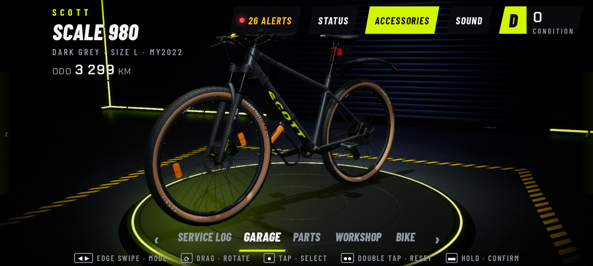<br>**Garage:** turntable, HUD and mode bar | 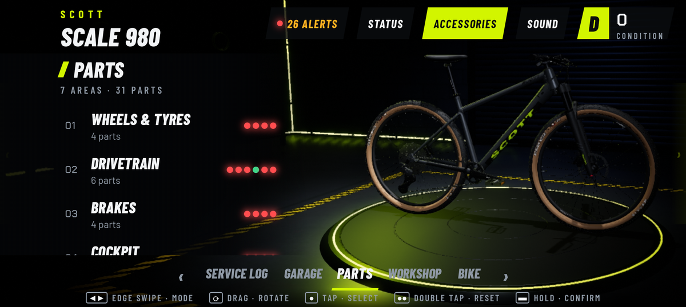<br>**Parts:** 7 areas, one condition dot per part |
| 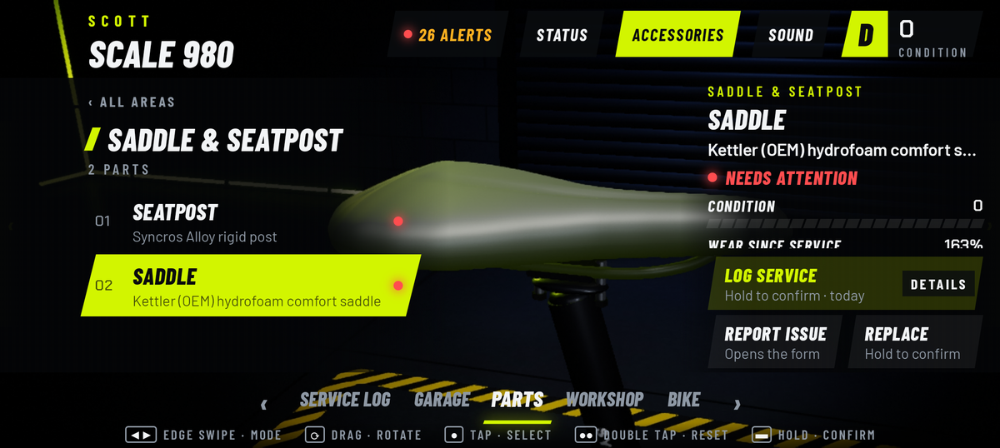<br>**Part card:** after the camera flies to the part | 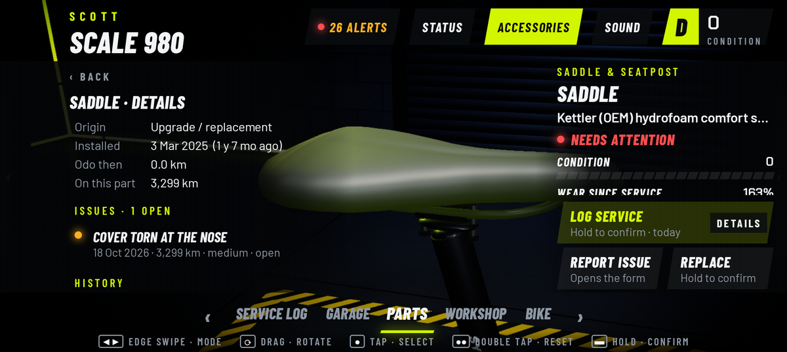<br>**Part details:** ownership, issues, history |
| 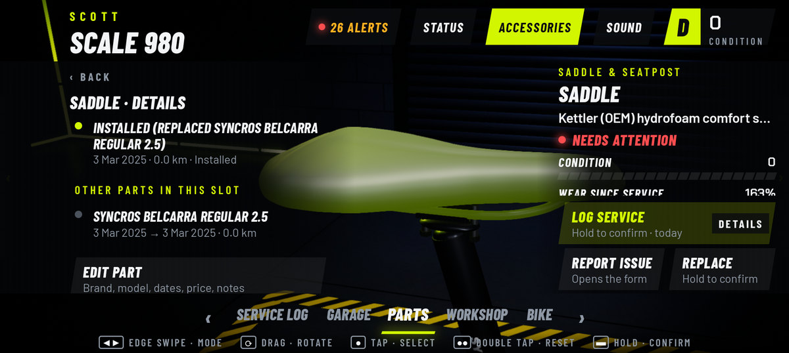<br>**Replacements:** other parts in the same slot | 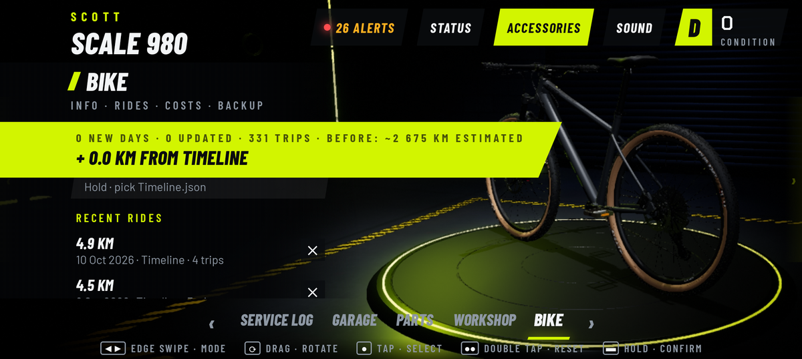<br>**Timeline import:** ride km from Google Maps |
| 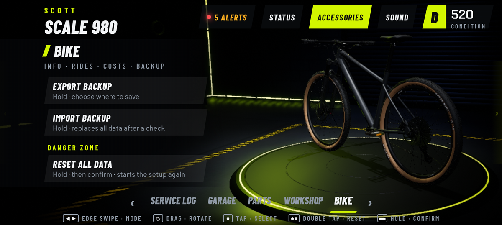<br>**Backup:** export / import, hold to confirm | 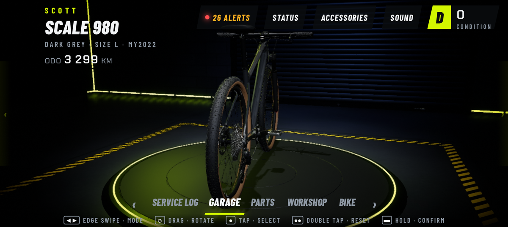<br>**Accessories off:** mudguards, lights, bell, lock and reflectors hidden |
| 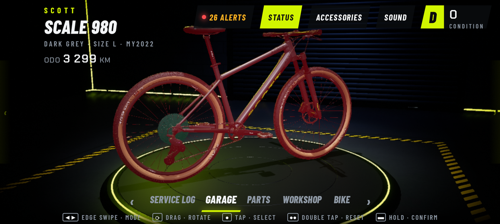<br>**Status view:** parts glow green / amber / red | 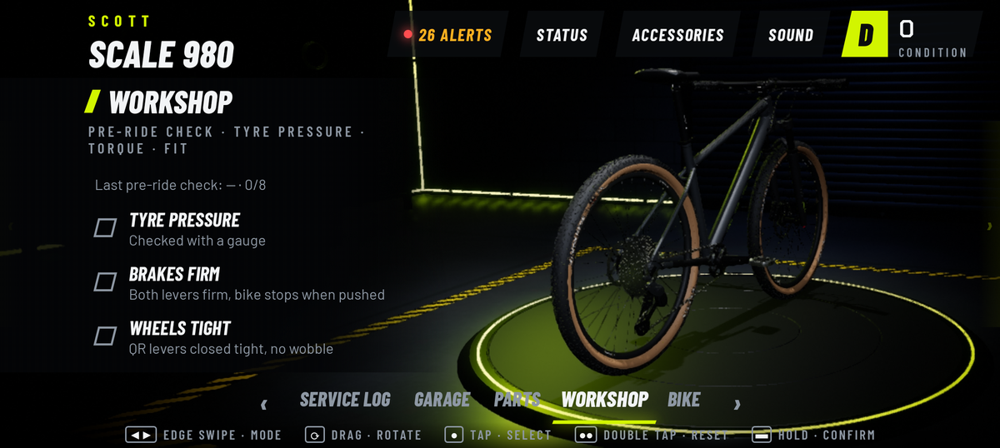<br>**Workshop:** pre-ride check, tyre pressure, torque, fit notes |
| 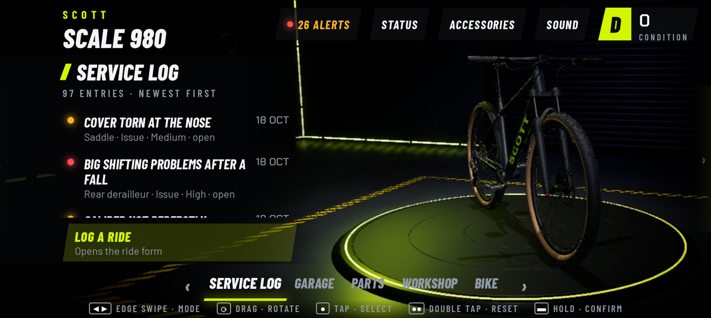<br>**Service log:** rides, services and issues, newest first | |

---

## The 3D model

<p align="center">
  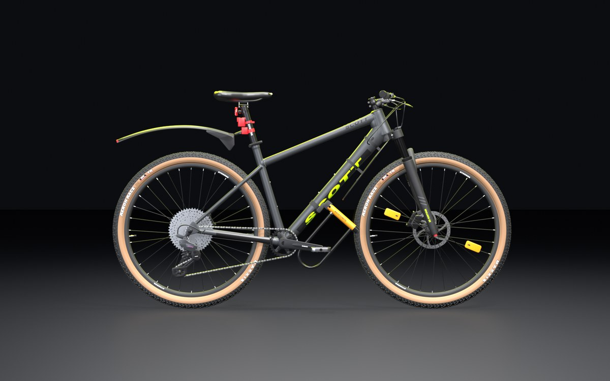
  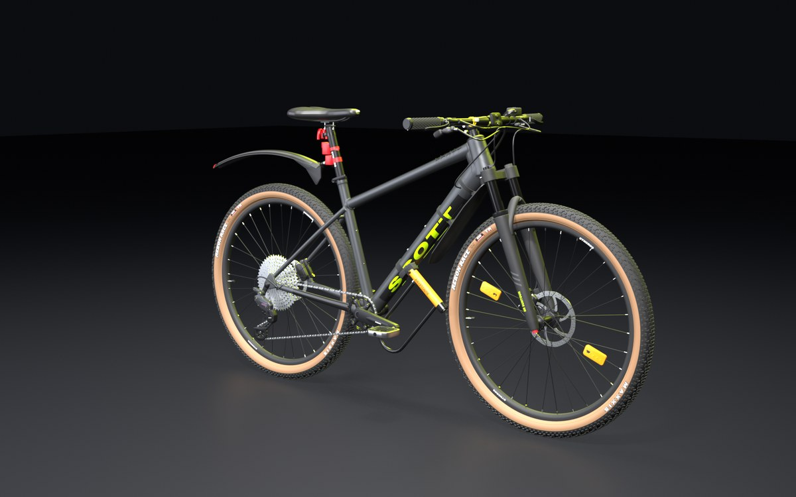
</p>

The bike is **not scanned and not modelled by hand**. Python scripts for Blender generate it from numbers:

- **Geometry** comes from SCOTT's official size-L geometry table (head angle, stack/reach, chainstays, wheelbase…). It is turned into 3D coordinates for the axles, head tube, seat tube and bottom bracket ([docs/BIKE-SPECS.md](docs/BIKE-SPECS.md)).
- **Parts** are built from measured or published sizes: a welded frame (tubes fused by voxel remeshing, TIG seams), the SR Suntour XCR32 fork, a Shimano Deore 12-speed drivetrain with real sprocket teeth and chain links, MT200 brakes with drilled rotors, laced wheels, and Maxxis Rekon Race tan-wall tyres with the real 3-row tread and sidewall text.
- **Checked against the real thing.** Renders were overlaid on SCOTT's studio photo to line up the shape. Toni's own changes (saddle, pedals, grips, top cap, accessories) were then added from photos of the real bike.
- **One mesh per part, named after its slot** (`frame`, `fork`, `chain`, `tire_front`, …). Wheels, rotors, cassette and crank have their origin on their rotation axis. Each node also carries `extras: {slot, category}`.
- The app ships a **Draco-compressed copy**: 2.4 MB for the bike and 0.3 MB for the garage, which is generated the same way by `build_garage.py`.

Details: [3d/README.md](3d/README.md).

---

## How it works

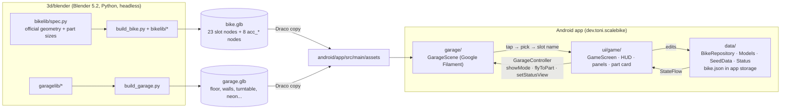

- **`data/` is the source of truth.** It holds one `BikeData` JSON document (parts, service events, issues, rides, bike info) in an in-memory `StateFlow`, which is written atomically to `bike.json` in app storage. Issue photos are copied into app storage too. Backup = export/import of that JSON.
- **`garage/`** runs plain Google Filament 1.75.1 (no SceneView). It loads the two glb files, sets up image-based lighting from a garage HDR, spotlights, soft shadows, screen-space floor reflections, bloom and fog, and does the turntable, the intro and the camera fly-tos. Every number to tune lives in `GarageTuning.kt`.
- **`ui/game/`** draws the game UI in Compose over the 3D view. It owns all touch handling: it decides whether a gesture is an edge swipe, a drag, a pinch or a tap, and calls the `GarageController` interface. The garage never reads touches itself.
- **Part slot names are the contract between data and 3D.** A `Part.slot` in the data is the name of a node in `bike.glb`. Tapping a node opens that slot's part, and status colours are applied per node.

### Part slots

`frame` · `fork` · `headset` · `stem` · `handlebar` · `grips` · `shifter` · `brake_front` · `brake_rear` · `rotor_front` · `rotor_rear` · `crankset` · `bottom_bracket` · `chain` · `cassette` · `derailleur` · `pedals` · `wheel_front` · `wheel_rear` · `tire_front` · `tire_rear` · `seatpost` · `saddle`

Accessories: `acc_mudguard_front` · `acc_mudguard_rear` · `acc_light_front` · `acc_light_rear` · `acc_light_clip` · `acc_bell` · `acc_lock` · `acc_reflectors`

`build_bike.py` checks every exported glb for all expected node names. The app's stock parts (`data/SeedData.kt`) use the ids `<slot>-stock`.

---

## Controls

The app runs in landscape and full screen.

| Gesture | Action |
|---|---|
| **Swipe from the left / right screen edge** (or tap the ◀ ▶ / mode tabs) | Change mode: SERVICE LOG · GARAGE · PARTS · WORKSHOP · BIKE |
| **Drag** on the bike | Orbit the camera |
| **Pinch** | Zoom |
| **Double tap** | Reset the camera |
| **Tap** a part | Select it: camera fly-to + part card |
| **Hold** a button | Confirm an important action (log service, replace, import, reset…) |
| **Back** | Close the card / panel, or go up one level |
| HUD chips | **ALERTS** · **STATUS** (condition glow) · **ACCESSORIES** (show/hide) · **SOUND** |
| Tap during the intro | Skip it |

---

## Build & run

You don't need Android Studio: everything works from the command line with Gradle and `adb`. The Draco-compressed models are already in `android/app/src/main/assets/`, so you don't need Blender to build the app.

**Requirements**
- JDK 21 (on `PATH` or as `JAVA_HOME`)
- Android SDK with platform **36** (point to it with `ANDROID_HOME` or `android/local.properties` → `sdk.dir=…`)
- The Gradle 8.13 wrapper downloads itself. Versions: AGP 8.13, Kotlin 2.2.20, compileSdk/targetSdk 36, **minSdk 31 (Android 12+)**
- An Android phone with USB debugging (`adb devices` should list it). The app is laid out for a Pixel 9 Pro in landscape (~915 × 412 dp).

**Build and install**

```bash
cd android
./gradlew installRelease      # optimized R8 build + install: use this one, it is much smoother
./gradlew assembleDebug       # debug APK → app/build/outputs/apk/debug/app-debug.apk (slower UI)
./gradlew installDebug        # debug build + install
```

On Windows, use `gradlew.bat` or run the same commands in Git Bash.

```bash
adb shell am start -n dev.toni.scalebike/.MainActivity   # start the app
adb logcat -d -b crash                                    # show crashes
```

> The release build is signed with the local **debug key** on purpose (it's a personal app), so release and debug builds install over each other and keep the data. Set up your own signing config before you share an APK.

On first launch, a short setup asks for the purchase date, the price and the km ridden so far, and whether the service timers should start today. After that the garage opens.

---

## Regenerate the 3D model

You only need this if you change the model. You need **Blender 5.2 LTS**; the scripts use the Python inside Blender and its glTF exporter.

```bash
# Bike: full glb + Draco copy for the app (+ optional preview renders)
blender --background --factory-startup --python 3d/blender/build_bike.py -- \
    --glb 3d/models/bike.glb --glb-draco android/app/src/main/assets/bike.glb

# Garage around the bike
blender --background --factory-startup --python 3d/blender/build_garage.py -- \
    --glb 3d/models/garage.glb --glb-draco android/app/src/main/assets/garage.glb
```

Useful options for `build_bike.py` (after `--`):
- `--render DIR` and `--views side_photo,front34,…` render preview images.
- `--no-accessories` builds only the 23 stock parts.
- `--blend FILE` also saves a `.blend` file.

All measurements live in `3d/blender/bikelib/spec.py`. Change a number and run the build again; never edit the glb by hand.
`python 3d/blender/compare_photo.py DIR/side_photo.png OUT_DIR` overlays the side render on the official studio photo (needs numpy + Pillow; the photo itself is not in the repo).

> **Fonts.** The decal text (SCOTT, SHIMANO, MAXXIS, …) is turned into geometry from Windows system fonts read at `C:/Windows/Fonts/` (Arial, Arial Black, Franklin Gothic, Segoe UI, Rockwell Extra Bold, Impact). These fonts are not included. On another OS, change the font paths in `bikelib/` and `garagelib/`.

More in [3d/README.md](3d/README.md): views, node contract, triangle budget, garage coordinates and the review viewer.

---

## Repository layout

```
.
├── README.md            ← you are here
├── LICENSE              ← MIT
├── android/             ← the app: Gradle project (Kotlin + Jetpack Compose + Filament)
│   └── app/src/main/
│       ├── java/dev/toni/scalebike/
│       │   ├── data/    ← data model, 23 stock parts, condition logic, storage, Timeline import
│       │   ├── garage/  ← 3D garage on Google Filament (scene, controller contract, tuning)
│       │   └── ui/      ← game UI (ui/game/), dialogs/forms, first-launch setup
│       ├── assets/      ← Draco bike.glb + garage.glb, garage HDR, font licence
│       └── res/         ← icon + splash (vector), fonts (OFL), UI sounds
├── 3d/                  ← procedural 3D pipeline
│   ├── blender/         ← generator scripts: build_bike.py + bikelib/, build_garage.py + garagelib/
│   ├── models/          ← full-detail bike.glb and garage.glb
│   ├── viewer/          ← makes a single-page HTML 3D viewer for reviewing the model
│   └── reference/       ← reference material (local)
├── design/              ← clickable UI prototype and the UI sound synthesizer (see design/README.md)
├── docs/                ← plan, progress checklist, bike spec + geometry, research (see docs/README.md)
│   └── media/           ← images used in this README
└── photos/              ← reference photos of the real bike (folder structure only, not in git)
```

---

## Status

This is a working personal app, used on the real bike. The 3D garage, game UI, part details, Timeline import and the performance pass are done. Next on the list: an upgrade wishlist with stat comparisons, a full timeline view and service reminders. Progress is tracked in [docs/CHECKLIST.md](docs/CHECKLIST.md) and the plan is in [docs/PLAN.md](docs/PLAN.md).

---

## Credits & licences

| What | Source | Licence |
|---|---|---|
| 3D engine | [Google Filament](https://github.com/google/filament) 1.75.1 (`filament-android`, `gltfio-android`, `filament-utils-android`) | Apache-2.0 |
| UI | Jetpack Compose, AndroidX (core, activity, lifecycle), Material 3 + icons | Apache-2.0 |
| JSON | [kotlinx.serialization](https://github.com/Kotlin/kotlinx.serialization) | Apache-2.0 |
| Images | [Coil](https://github.com/coil-kt/coil) 2.7.0 | Apache-2.0 |
| Fonts in the app | [Barlow / Barlow Condensed](https://github.com/jpt/barlow) and [Chakra Petch](https://github.com/m4rc1e/Chakra-Petch), via Google Fonts. See [`OFL.txt`](android/app/src/main/assets/licenses/OFL.txt) | SIL Open Font License 1.1 |
| Garage lighting (HDR) | [“Parking Garage”](https://polyhaven.com/a/parking_garage) by Greg Zaal, Poly Haven (1k version, `assets/envs/garage.hdr`) | CC0 |
| Prototype / review viewer | [three.js](https://threejs.org) r147, loaded from a CDN | MIT |
| UI sounds | Synthesized by `design/sounds/make_sounds.py` | part of this project |
| 3D model and garage | Generated by the scripts in `3d/blender/` | part of this project |

Facts about the bike come from SCOTT's public product page and geometry table (see [docs/research/SOURCES.md](docs/research/SOURCES.md)). Reference photos and videos used while modelling are **not** in this repository.

---

## Disclaimer

This is a personal fan project. It is **not affiliated with, endorsed by or sponsored by** SCOTT Sports, Syncros, Shimano, SR Suntour, Maxxis, KMC, WTB, Giant, Kettler, Cane Creek, Polisport, Kryptonite, McDonald's, Google or any other company named here. Brand names, logos and product names that appear in the app, the 3D model or the docs belong to their owners. They are used only to describe this one bike and its parts.

The service intervals, torque values and tyre pressures in the app are general reference values for my own bike. Always follow the manufacturer's instructions for your parts.

---

## License

**MIT**. See [LICENSE](LICENSE).

Third-party assets keep their own licences: the fonts are SIL OFL 1.1, the garage HDR is CC0, and Google Filament and the other libraries are Apache-2.0 (see [Credits & licences](#credits--licences)). Brand names and logos reproduced in the 3D model (for example on decals and tyre sidewalls) belong to their owners and are not covered by the MIT licence.
